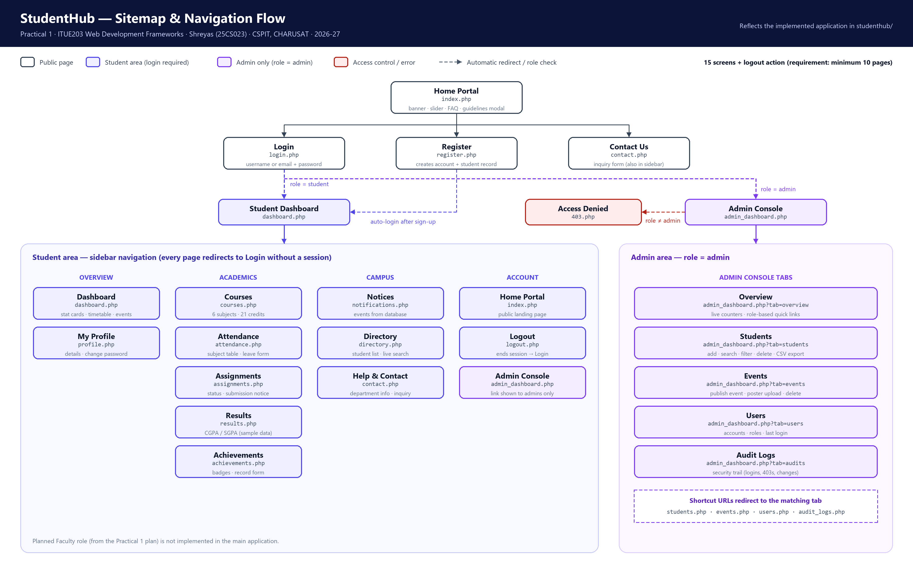
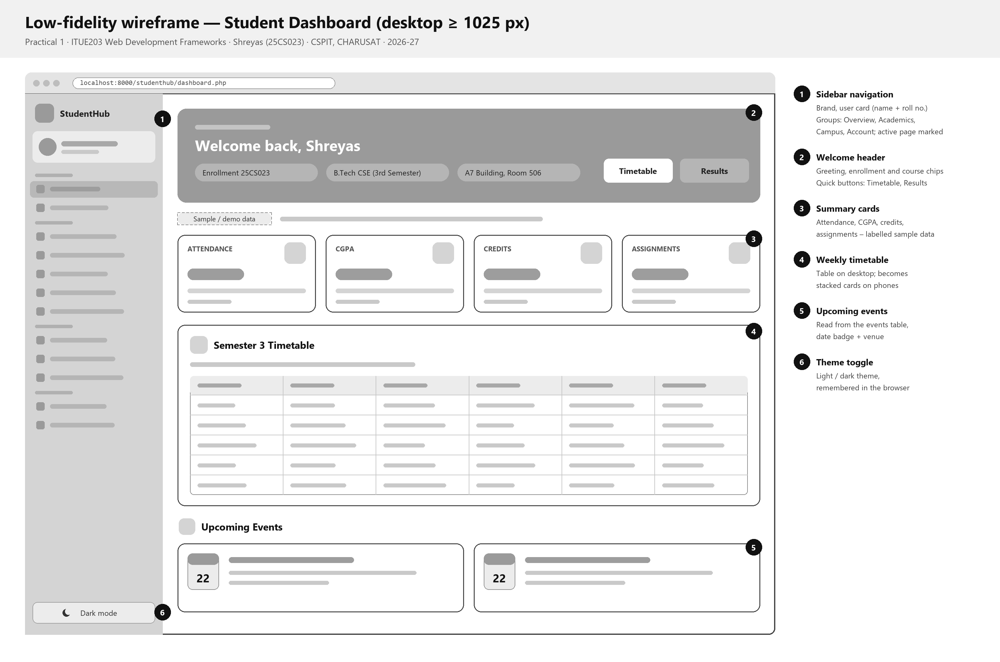

<div align="center">
  <h1>🎓 Practical 1</h1>
  <h3>Initiation & Planning of StudentHub Portal</h3>
</div>

---

### 👨‍🎓 Student Information
- **Name:** Shreyas
- **ID:** 25CS023
- **Course:** ITUE203 - WEB DEVELOPMENT FRAMEWORKS
- **Year:** 2026-27

---

### 🎯 Objective
> To initiate the development of the StudentHub Portal by analyzing project requirements, identifying user roles and modules, designing the sitemap and low-fidelity wireframes, organizing the project folder structure, and setting up a GitHub repository for future development.

---

### 📝 Problem Statement
Initiate the semester-long StudentHub portal by identifying the problem scope, user roles, key modules, navigation flow, and minimum 10 pages. Create a sitemap, low-fidelity wireframe, project folder structure, README file, and GitHub repository.

---

### 📦 Submission Deliverables
| # | Deliverable | Where |
|---|---|---|
| 1 | Complete StudentHub project folder | This repository: `studenthub/` (main application), `Practical-1` … `Practical-15`, `database/`, `tools/`, `README.md` |
| 2 | GitHub repository screenshot | [`screenshots/github-repository.png`](screenshots/) – **placeholder, genuine screenshot not added yet** (also section 12 of the Word report) |
| 3 | GitHub repository link | [https://github.com/TheEmperor08/StudentHub-ITUE203-25CS023](https://github.com/TheEmperor08/StudentHub-ITUE203-25CS023) |
| 4 | Sitemap PDF | [`PRAC_1_Sitemap_25CS023.pdf`](PRAC_1_Sitemap_25CS023.pdf) – 1 page, A4 landscape |
| 5 | Low-fidelity wireframe PDF | [`PRAC_1_Wireframes_25CS023.pdf`](PRAC_1_Wireframes_25CS023.pdf) – 3 pages, A4 landscape: dashboard (desktop), home + login (desktop), mobile |

Lab report: [`PRAC_1_ITUE203_25CS023.docx`](PRAC_1_ITUE203_25CS023.docx)

---

### 👥 User Roles
1. **Student:** Access dashboard, view timetable, attendance, marks, events, and manage profile. *(implemented)*
2. **Faculty:** Manage courses, upload assignments, update attendance, and check results. *(planned – not implemented in the main application)*
3. **Admin:** Manage users, student records, events and audit logs from the Admin Console. *(implemented)*

---

### 🗺️ Sitemap & Navigation Flow
The sitemap reflects the application as implemented in `studenthub/` (15 screens + logout; requirement: minimum 10 pages).



- **Public:** Home ➔ Login | Register | Contact Us
- **Student area (login required, sidebar navigation):**
  - Overview: Dashboard, My Profile
  - Academics: Courses, Attendance, Assignments, Results, Achievements
  - Campus: Notices, Directory, Help & Contact
  - Account: Home Portal, Logout
- **Admin only:** Admin Console tabs – Overview, Students (CSV export), Events (poster upload), Users, Audit Logs
- **Access control:** non-admins opening the Admin Console see the 403 page.

---

### 🧩 Low-Fidelity Wireframes
Greyscale wireframes of the key screens (layout only – these are not screenshots).

| Screen | File |
|---|---|
| Student dashboard (desktop) | [`wireframe-1-dashboard-desktop.png`](wireframe-1-dashboard-desktop.png) |
| Home page and login (desktop) | [`wireframe-2-home-login-desktop.png`](wireframe-2-home-login-desktop.png) |
| Mobile: dashboard, navigation drawer, login | [`wireframe-3-mobile.png`](wireframe-3-mobile.png) |



---

### 📂 Project Structure
```text
StudentHub/
├── studenthub/        # Main application (PHP + MySQL)
├── Practical-1/       # This planning practical: sitemap + wireframes
├── Practical-2 … 15/  # Practical-wise deliverables
├── database/          # Safe demo SQL for studenthub_db
├── tools/             # CLI helper for creating local demo accounts
├── README.md
└── TEST_REPORT.md
```

```text
Practical-1/
├── README.md
├── sitemap.svg / sitemap.png
├── wireframe-1-dashboard-desktop.svg / .png
├── wireframe-2-home-login-desktop.svg / .png
├── wireframe-3-mobile.svg / .png
├── PRAC_1_Sitemap_25CS023.pdf       # sitemap deliverable (1 page)
├── PRAC_1_Wireframes_25CS023.pdf    # wireframe deliverable (3 pages)
├── PRAC_1_ITUE203_25CS023.docx      # lab report
├── screenshots/                     # genuine GitHub repository screenshot goes here
└── source/
    ├── build_diagrams.py            # regenerates the SVG + PNG diagrams
    └── export_pdfs.py               # exports the PNG diagrams to the two PDFs
```
SVG files are the editable vector originals; the PNG files are used in the Word report and the PDFs. Regenerate with `python Practical-1/source/build_diagrams.py`, then `python Practical-1/source/export_pdfs.py`.

---

### 💻 Source Code Evidence
Practical 1 is a planning practical (design artefacts only). The table below points to the real StudentHub code that implements the planned page structure and navigation flow; the lab report quotes these lines unchanged.

| File | Lines | Shows |
|---|---|---|
| [`studenthub/index.php`](../studenthub/index.php) | 18–27 | Home page document structure and metadata: doctype, `lang`, charset, viewport, title, stylesheet, theme script |
| [`studenthub/index.php`](../studenthub/index.php) | 36–65 | Home page `<header>` and main `<nav>`: guest links vs. signed-in links, admin-only Admin Console link, hamburger button |
| [`studenthub/sidebar.php`](../studenthub/sidebar.php) | 8–32 | `$nav_groups` navigation map (Overview, Academics, Campus, Account – matches the sitemap) and the skip link |
| [`studenthub/sidebar.php`](../studenthub/sidebar.php) | 67–78 | Loop that renders the menu, marks the current page and adds the admin-only link |

The skip link is part of `sidebar.php`, so it appears on the signed-in pages; the public home page (`index.php`) does not have one. `Practical-15/` contains an identical copy of these files.

---

### 🔗 GitHub Repository
**Repository:** [https://github.com/TheEmperor08/StudentHub-ITUE203-25CS023](https://github.com/TheEmperor08/StudentHub-ITUE203-25CS023)

```bash
git clone https://github.com/TheEmperor08/StudentHub-ITUE203-25CS023.git
```
