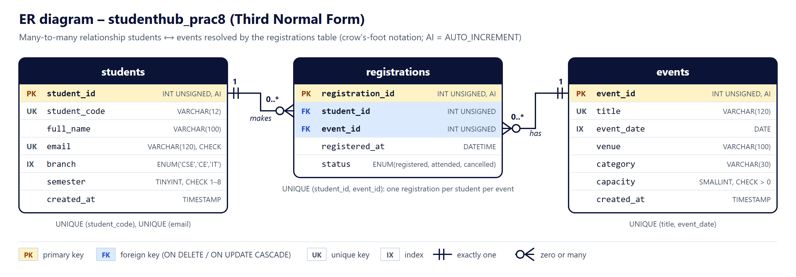

<div align="center">
  <h1>🎓 Practical 8</h1>
  <h3>MySQL Schema Design (3NF) and Secure PHP PDO Connectivity</h3>
</div>

---

### 👨‍🎓 Student Information
- **Name:** Shreyas
- **ID:** 25CS023
- **Course:** ITUE203 - WEB DEVELOPMENT FRAMEWORKS
- **Year:** 2026-27

---

### 🎯 Objective
> Design a normalised (3NF) MySQL database for StudentHub with the tables `students`, `events` and `registrations`, import it with phpMyAdmin, and connect to it from PHP using PDO with exception handling, UTF-8 and prepared statements.

---

### 🚀 How to Run (Windows + XAMPP + phpMyAdmin)
**Requirement:** XAMPP installed in `C:\xampp` (PHP 8.1 or newer; tested with XAMPP's PHP 8.2.12 and MariaDB 10.4.32).

**1. Start the services**
Open the **XAMPP Control Panel** and click **Start** next to **Apache** and **MySQL**.

**2. Import the database with phpMyAdmin**
1. Open **http://localhost/phpmyadmin**.
2. Click the **Import** tab at the top (no database needs to be selected – the file creates its own).
3. Under *File to import*, click **Choose File** and select `Practical-8\schema.sql`.
4. Leave the other options as they are (format **SQL**) and click **Import** at the bottom.
5. phpMyAdmin shows *"Import has been successfully finished, 17 queries executed."* The left panel now has the database **studenthub_prac8** with the tables `events`, `registrations` and `students`.

`schema.sql` only creates and fills `studenthub_prac8`; no other database is changed. Importing it again resets the three tables to the sample data.

*Messages you may see:* with the server-level Import tab, phpMyAdmin 5.2.1 also shows *"Error: #1046 No database selected"* after the SET, USE and procedure statements. These come from phpMyAdmin's own extra queries when no database is selected in its interface: each statement itself succeeded, and the same file imported with the MySQL client or from the database's Import tab shows no such message. To re-import without them, click **studenthub_prac8** in the left panel first and use its **Import** tab. *"Note: #1007 … database exists"* on a re-import is expected.
*Command line alternative:* `C:\xampp\mysql\bin\mysql.exe -u root < schema.sql`

**3. Open the connection test page**

*Option A – PHP built-in server (used for testing)*
1. Double-click **`start-server.bat`** in the `Practical-8` folder. It uses `C:\xampp\php\php.exe` and opens **http://127.0.0.1:8608/test_connection.php** after about 2 seconds (press **F5** if the page is not ready yet).
2. Or, in Command Prompt inside the `Practical-8` folder:
   ```bat
   C:\xampp\php\php.exe -S 127.0.0.1:8608 router.php
   ```
3. Keep the window open; stop the server with **Ctrl+C**.

*Option B – XAMPP Apache*
Copy the `Practical-8` folder to `C:\xampp\htdocs\practical8` and open **http://localhost/practical8/test_connection.php**. `.htaccess` blocks the configuration files and tests. *Option B was not tested; only Option A was tested.*

**Database settings:** `db.php` uses XAMPP's defaults (`127.0.0.1`, port `3306`, user `root`, empty password, database `studenthub_prac8`). If your MySQL is different, copy `config.example.php` to `config.local.php` and change the values there. `config.local.php` is ignored by Git, so a password is never committed.

---

### 🗄️ Database Design
| Table | Primary key | Foreign keys | Other keys and constraints |
|---|---|---|---|
| `students` | `student_id` (INT UNSIGNED, AUTO_INCREMENT) | – | UNIQUE `student_code`, UNIQUE `email`; INDEX `branch`; `branch` ENUM('CSE','CE','IT'); CHECK `semester` 1–8; CHECK email format |
| `events` | `event_id` | – | UNIQUE (`title`, `event_date`); INDEX `event_date`; CHECK `capacity` > 0 |
| `registrations` | `registration_id` | `student_id` → `students`, `event_id` → `events` (ON DELETE/UPDATE CASCADE) | UNIQUE (`student_id`, `event_id`); `status` ENUM('registered','attended','cancelled') |



**Third Normal Form**
- **1NF:** every column holds one value (no lists such as "events: 1, 3, 5"); every table has a primary key.
- **2NF:** every primary key is a single column, so no column can depend on only part of a key.
- **3NF:** no column depends on another non-key column. Student details are stored only in `students`, event details only in `events`; `registrations` stores just the two IDs plus facts about that registration (`registered_at`, `status`). Changing an event's venue therefore changes one row, not every registration.

The many-to-many relationship (a student joins many events; an event has many students) is resolved by `registrations`.

**Sample data (fictional):** 8 students (`DEMO-S001`–`DEMO-S008`, `@example.com` addresses), 5 events and 12 registrations. The Inter-college Hackathon (capacity 4) is full, to demonstrate the capacity check.

**Advanced extension – stored procedures:** `get_event_roster(event_id)` lists the students of an event; `register_student_for_event(student_id, event_id)` refuses unknown events and full events (`SIGNAL SQLSTATE '45000'`).

---

### 🔐 PDO Connection (`db.php`)
- `get_db()` returns one shared `PDO` object; DSN `mysql:host=…;port=…;dbname=studenthub_prac8;charset=utf8mb4`.
- `PDO::ERRMODE_EXCEPTION` (every SQL error throws), `PDO::FETCH_ASSOC`, `PDO::ATTR_EMULATE_PREPARES = false` (real server-side prepared statements).
- Strict SQL mode for the session, because XAMPP's `my.ini` is not strict and would otherwise silently store an invalid value (found by the tests: branch `'XYZ'` was saved as `''`).
- `try`/`catch`: the real error goes to the PHP error log; the page receives a general `RuntimeException` and shows *"Could not connect to the studenthub_prac8 database…"* – no host, user, password or SQLSTATE. `display_errors` is turned off.
- Opening `db.php` directly in the browser returns 403.

`test_connection.php` uses only prepared statements: the database name and version, table names and keys (from `information_schema` with a bound `:schema`), the row counts, all records (`LIMIT :limit` bound as an integer), a JOIN of registrations with students and events, a `WHERE branch = :branch` filter (`?branch=CE`, only CSE/CE/IT accepted) and `CALL get_event_roster(:event_id)`. Every value is escaped with `htmlspecialchars()`.

---

### 📂 Files
```text
Practical-8/
├── schema.sql              # database, 3 tables, keys, constraints, sample data, procedures (phpMyAdmin import)
├── db.php                  # secure PDO connection (get_db)
├── test_connection.php     # connection status, tables, keys and records
├── config.example.php      # template for an optional config.local.php (git-ignored)
├── assets/css/style.css
├── router.php              # blocks config/tests on PHP's built-in server
├── start-server.bat        # Windows: XAMPP PHP server on port 8608
├── .htaccess               # same protection on Apache
├── docs/er-diagram.svg/.png
├── screenshots/            # connection test, error page and phpMyAdmin screenshots (6 PNG files)
└── tests/test_db.php, tests/test_page.py
```
The earlier version of this practical (`insert.php`, `students.php` and the `practical8_db` database) was replaced by this design; the old database is no longer used and was not changed.

---

### 🧪 Testing
With MySQL running and `schema.sql` imported, in the `Practical-8` folder:
```bat
python tests\test_page.py
```
It runs `php -l` on every PHP file, `tests\test_db.php` (also runnable alone: `C:\xampp\php\php.exe tests\test_db.php`), the page tests on port 8608 and the error tests on ports 8611–8614. Data changes are made inside transactions that are rolled back.

**Result: `tests/test_db.php` 44 of 44 passed; `tests/test_page.py` 44 of 44 passed** (PHP 8.2.12, MariaDB 10.4.32, Windows 11).

| # | Area | What was checked | Result |
|---|---|---|---|
| 1 | SQL import | `schema.sql` imported with phpMyAdmin's Import page (server level and database level, file chosen in Edge): *"Import has been successfully finished, 17 queries executed"*; re-import also works; MySQL client import shows no warnings except the expected Note 1007 | pass |
| 2 | Tables | exactly `students`, `events`, `registrations`; InnoDB; utf8mb4_unicode_ci; no NULL columns; data types as designed | pass |
| 3 | Keys | 3 primary keys; 2 foreign keys with CASCADE; 4 unique keys; 3 indexes; 3 CHECK constraints | pass |
| 4 | Seed data | 8 / 5 / 12 rows; all DEMO-S codes and example.com; no orphan registrations; no event over capacity | pass |
| 5 | PDO connection | database `studenthub_prac8`; exception mode; native prepares; FETCH_ASSOC; utf8mb4; strict mode | pass |
| 6 | Prepared statements | named and positional placeholders; `bindValue(PARAM_INT)`; `CSE' OR '1'='1` returns 0 rows; `O'Neil` stored correctly | pass |
| 7 | Constraints | unknown student/event → 1452; duplicate registration/email → 1062; semester 9, email `abc`, capacity 0 → 4025; branch `XYZ` → 1265; delete/update cascades | pass |
| 8 | Procedures | roster of event 1 = 4 students; full event → "Event is full"; unknown event → "Event not found"; free place → new ID | pass |
| 9 | Page output | 200; "Connected successfully"; table names, row counts, keys; all records; JOIN; `?branch=IT/CE`; injection text and `branch[]` fall back to CSE | pass |
| 10 | Error handling | wrong database, wrong password, MySQL unreachable → 500 + general message; tables missing → 500 + "tables were not found"; no user, host, port, SQLSTATE in the page; real error in the PHP log | pass |
| 11 | Protected files | `db.php` → 403; `config.*.php`, `tests/`, `.gitignore`, `.htaccess`, `router.php`, `start-server.bat` → 403 | pass |

Bugs found by the tests and fixed: invalid ENUM values were accepted (fixed with strict mode in `db.php`); a query error was reported as a connection error because `PDOException` extends `RuntimeException` (catch order fixed).

**Screenshots** (`screenshots/`, genuine Microsoft Edge 156 renders):
- `database-connection.png` – `test_connection.php` connected to `studenthub_prac8`
- `connection-error.png` – the same page started with a wrong password (general message only)
- `phpmyadmin-import-form.png`, `phpmyadmin-import.png` – phpMyAdmin Import tab with `schema.sql` chosen, and the result
- `phpmyadmin-tables.png` – phpMyAdmin structure of `studenthub_prac8` after the import
- `phpmyadmin-foreign-keys.png` – phpMyAdmin relation view of `registrations` (both CASCADE foreign keys)

**Not tested:** XAMPP Apache (Option B), MySQL 8 (only MariaDB 10.4), other browsers.
