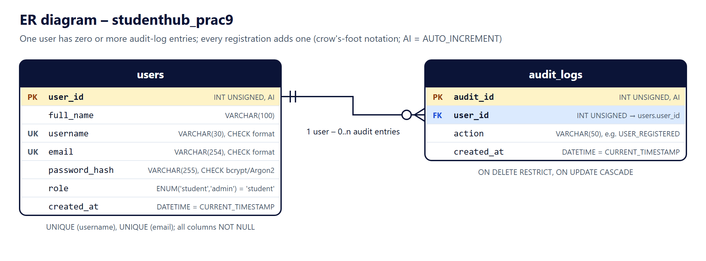

<div align="center">
  <h1>🎓 Practical 9</h1>
  <h3>Secure User Registration with Database Insert, Duplicate Email Check, and Password Hashing</h3>
</div>

---

### 👨‍🎓 Student Information
- **Name:** Shreyas
- **ID:** 25CS023
- **Course:** ITUE203 - WEB DEVELOPMENT FRAMEWORKS
- **Year:** 2026-27

---

### 🎯 Aim and Objectives
> Build a secure StudentHub registration form that validates input in the browser and on the server, refuses duplicate emails and usernames, stores passwords only as `password_hash()` hashes and inserts the user into MySQL with MySQLi prepared statements.

- Validate every field twice: JavaScript for quick feedback, PHP because the browser can be bypassed.
- Refuse an email address or username that is already registered, both in PHP and with UNIQUE keys in MySQL.
- Never store, show or log a plaintext password.
- Use prepared statements for every query that contains user input.
- Advanced extension: CSRF token and an audit-log entry for every successful registration.

**Problem definition:** a registration form is the first thing an attacker meets. Without server-side checks it accepts empty or invalid data, without duplicate checks one email can own several accounts, plaintext passwords are exposed by any database leak, and SQL built from user input allows SQL injection.

---

### 🛠️ Technologies
PHP 8.2.12 (XAMPP) with **MySQLi**, MariaDB 10.4.32 (XAMPP's MySQL server), phpMyAdmin 5.2.1, HTML5, CSS3, JavaScript, Microsoft Edge (screenshots), Python 3 (test script only).

---

### 🚀 How to Run (Windows + XAMPP)
**Requirement:** XAMPP in `C:\xampp` (PHP 8.1 or newer with the mysqli extension, which XAMPP enables by default).

**1. Start the services:** open the **XAMPP Control Panel** and click **Start** next to **Apache** and **MySQL**.

**2. Import the database with phpMyAdmin**
1. Open **http://localhost/phpmyadmin**.
2. Click the **Import** tab at the top (no database needs to be selected – the file creates its own).
3. Under *File to import*, click **Choose File** and select `Practical-9\schema.sql`.
4. Keep the format **SQL** and click **Import** at the bottom.
5. phpMyAdmin shows *"Import has been successfully finished, 7 queries executed."* The left panel now lists **studenthub_prac9** with the tables `audit_logs` and `users` (refresh the panel if it does not appear).

`schema.sql` only creates `studenthub_prac9`; no other database is changed. Importing it again is safe: existing tables and registered users are kept, and the notes *#1007 database exists* and *#1050 table already exists* are expected.

*Messages you may see:* when the file is imported from the server-level Import tab, phpMyAdmin 5.2.1 also shows *"Error: #1046 No database selected"* under some statements. These come from phpMyAdmin's own extra queries while no database is selected; every statement of `schema.sql` still runs (the same happened in Practical 8). To avoid them on a re-import, click **studenthub_prac9** in the left panel first and use its **Import** tab.

*Command line alternative:* `C:\xampp\mysql\bin\mysql.exe -u root < schema.sql`

**3. Open the registration form**

*Option A – PHP built-in server (used for testing)*
1. Double-click **`start-server.bat`** in the `Practical-9` folder. It uses `C:\xampp\php\php.exe` and opens **http://127.0.0.1:8609/register.php** after about 2 seconds (press **F5** if the page is not ready yet).
2. Or, in Command Prompt inside the `Practical-9` folder:
   ```bat
   C:\xampp\php\php.exe -S 127.0.0.1:8609 router.php
   ```
3. Keep the window open; stop the server with **Ctrl+C**.

*Option B – XAMPP Apache*
Copy the `Practical-9` folder to `C:\xampp\htdocs\practical9` and open **http://localhost/practical9/register.php**. `.htaccess` blocks the configuration files, `includes/` and `tests/`. *Option B was not tested; only Option A was tested.*

**4. Check the result in phpMyAdmin:** click `studenthub_prac9` → `users` (the `password_hash` column holds a hash such as `$2y$10$…`, never the password) and `audit_logs` (one `USER_REGISTERED` row per registration).

**Database settings:** `db.php` uses XAMPP's defaults (`127.0.0.1`, port `3306`, user `root`, empty password, database `studenthub_prac9`). If your MySQL is different, copy `config.example.php` to `config.local.php` and change the values there. `config.local.php` is ignored by Git, so a password is never committed.

---

### 🗄️ Database Design (`studenthub_prac9`)


| Table | Columns | Keys and constraints |
|---|---|---|
| `users` | `user_id` INT UNSIGNED AUTO_INCREMENT, `full_name` VARCHAR(100), `username` VARCHAR(30), `email` VARCHAR(254), `password_hash` VARCHAR(255), `role` ENUM('student','admin') DEFAULT 'student', `created_at` DATETIME | PK `user_id`; UNIQUE `username`, UNIQUE `email`; CHECK username format; CHECK email format; CHECK that `password_hash` looks like a bcrypt/Argon2 hash (the database itself refuses plaintext) |
| `audit_logs` | `audit_id` INT UNSIGNED AUTO_INCREMENT, `user_id`, `action` VARCHAR(50), `created_at` DATETIME | PK `audit_id`; FK `user_id` → `users.user_id` (ON DELETE RESTRICT, ON UPDATE CASCADE) |

All columns are NOT NULL; both tables are InnoDB with `utf8mb4_unicode_ci`. This collation ignores letter case, so `Demo_Asha` counts as a duplicate of `demo_asha`.

**Sample data (fictional):** `demo_asha`, `demo_kabir`, `demo_meera` with `@example.com` addresses and one audit entry each. Their hashes were made from random passwords that were thrown away, so nobody knows a password for them; they exist to demonstrate the duplicate checks.

---

### 🔄 Registration Workflow
1. **GET `register.php`** – starts a session and shows the form with a hidden CSRF token.
2. **POST `register.php`** – checks the CSRF token first (missing or wrong → **403**, nothing is processed).
3. **Server-side validation** (`includes/registration.php`) – errors → **422**, the form is shown again with a message next to each field and a summary at the top; name, username, email and the terms tick are kept, the passwords are not.
4. **Duplicate check** – two prepared `SELECT`s, one for the username and one for the email.
5. **`password_hash($password, PASSWORD_DEFAULT)`** (bcrypt in PHP 8.2).
6. **Transaction** – `INSERT INTO users` and `INSERT INTO audit_logs`, then `COMMIT`; any error → `ROLLBACK` of both.
7. **Success** – new session ID (`session_regenerate_id(true)`), new CSRF token, **303** redirect to `register.php?registered=1`, which shows the confirmation once (refreshing does not submit again).
8. **Database unavailable** – **503** with a general message; the real error goes only to the PHP error log.

---

### ✅ Validation
| Field | Browser (`assets/js/register.js`) and server (`includes/registration.php`) rule |
|---|---|
| Full name | required; 2–100 characters; letters, spaces, `'`, `-`, `.`; spaces trimmed |
| Username | required; 3–30 characters; letters, numbers and `_`, starting with a letter |
| Email | required; valid address (`filter_var(..., FILTER_VALIDATE_EMAIL)` on the server); max 254 characters |
| Password | required; 8–72 characters (bcrypt uses only the first 72 bytes); an uppercase letter, a lowercase letter, a number and a special character |
| Confirm password | required; must equal the password |
| Terms | the checkbox must be ticked |

The server also refuses values sent as arrays (`username[]=x`), invalid UTF-8 and any extra field such as `role=admin` (ignored – every new account is a `student`). Every value printed in the page goes through `htmlspecialchars()`.

**Frontend:** HTML5 types (`email`, `password`), labels for every field, `aria-invalid` and `aria-describedby` on fields with errors, inline messages while typing and on submit, an error summary that receives keyboard focus, and a **password strength indicator** (bar, Very weak → Strong, and a checklist of the five rules). The page works without JavaScript because the server repeats every check.

---

### 🔐 Security
- **Password hashing:** only the result of `password_hash()` is stored; `password_verify()` was used in the tests to prove that the stored hash matches the password. No password is shown, logged or written to any file, and the database `CHECK` constraint refuses a value that is not a hash.
- **Duplicates:** checked with prepared statements before inserting, and enforced by the UNIQUE keys. If two requests register the same username at the same moment, the second `INSERT` fails with MySQL error 1062, which is caught, rolled back and shown as the same friendly message.
- **Prepared statements:** every query with user input uses `prepare()`, `bind_param()` and `execute()`; nothing typed by the user is concatenated into SQL. MySQLi is set to throw exceptions (`mysqli_report`), and the connection uses strict SQL mode.
- **CSRF:** a 64-character token from `random_bytes(32)`, stored in the session, compared with `hash_equals()`; missing, wrong, array or other-session tokens are rejected with 403. The token is replaced after a successful registration.
- **Session:** cookie `P9SESSID` with `HttpOnly`, `SameSite=Strict`, `Secure` on HTTPS, strict mode and cookies only.
- **Headers:** Content-Security-Policy (scripts and styles only from this site, no framing), `X-Frame-Options: DENY`, `X-Content-Type-Options: nosniff`, `Referrer-Policy`, `Cache-Control: no-store`.
- **Errors:** `display_errors` is off; database errors are written to the PHP error log (never with a password or hash) and the user sees only a general message. `db.php`, `includes/`, `tests/` and the configuration files return 403.
- **Audit log:** one `USER_REGISTERED` row per successful registration, written in the same transaction as the user; failed attempts create no entry.

---

### 📂 Project Structure
```text
Practical-9/
├── register.php            # registration form and POST handling (controller + view)
├── index.php               # redirects the folder address to register.php
├── db.php                  # MySQLi connection to studenthub_prac9 (get_db)
├── includes/
│   ├── registration.php    # validation, duplicate checks, password_hash, user + audit transaction
│   └── security.php        # session cookie settings, CSRF token, security headers, e()
├── schema.sql              # database, 2 tables, keys, constraints, fictional sample data (phpMyAdmin import)
├── assets/css/style.css, assets/js/register.js, assets/img/favicon.svg
├── config.example.php      # template for an optional config.local.php (git-ignored)
├── router.php              # blocks config/includes/tests on PHP's built-in server
├── start-server.bat        # Windows: XAMPP PHP server on port 8609
├── .htaccess               # same protection on Apache
├── docs/er-diagram.svg/.png
├── screenshots/            # 14 PNG files (see below)
├── tests/test_app.py, tests/test_registration.php, tests/test_database.php
└── PRAC_9_ITUE203_25CS023.docx / .pdf
```

---

### 🧪 Testing
With MySQL running, in the `Practical-9` folder:
```bat
python tests\test_app.py
```
It runs `php -l` on every PHP file, `tests\test_registration.php` (also runnable alone: `C:\xampp\php\php.exe tests\test_registration.php`), the web tests on port 8609 and the database-unavailable test on port 8619. The tests use a separate database, **`studenthub_prac9_test`**, which is created from `schema.sql` and removed again, so `studenthub_prac9` is never changed. Test passwords are random and never printed.

**Result: `tests/test_registration.php` 93 of 93 passed; `tests/test_app.py` 78 of 78 passed** (PHP 8.2.12, MariaDB 10.4.32, Windows 11).

| # | Test case | Result |
|---|---|---|
| 1 | Form loads (200, six labelled fields, CSRF token, secure cookie and headers) | pass |
| 2 | Empty fields → 422 with a message under each of the six fields | pass |
| 3 | Invalid email (`not-an-email`, `name@example`, `x@example.com' OR '1'='1`, …) → "Enter a valid email address…" | pass |
| 4 | Password mismatch → "Passwords do not match." | pass |
| 5 | Duplicate email (`asha.demo@example.com`, also in capitals) → "An account with this email address already exists." | pass |
| 6 | Duplicate username (`demo_kabir`, also `DEMO_KABIR`) → "This username is already taken…" | pass |
| 7 | Valid registration → 303, confirmation page, new session ID | pass |
| 8 | Database insertion: one `users` row with the submitted values, role `student` | pass |
| 9 | `password_hash` holds a 60-character `$2y$10$…` bcrypt hash, not the password | pass |
| 10 | `password_verify()` is true for the password and false for a wrong one | pass |
| 11 | Prepared statements: injection text `x' OR '1'='1` finds nothing; `O'Neil` and `Zoë` stored correctly | pass |
| 12–13 | Invalid / missing / other-session / array CSRF token → 403, nothing saved | pass |
| 14 | SQL injection-style input refused or stored only as data; `<script>` escaped; `username[]` handled | pass |
| 15 | Audit log: exactly one `USER_REGISTERED` row for the new user | pass |
| 16 | Failed registrations create no user and no audit entry | pass |
| 17 | MySQL constraints: duplicate username/email → 1062 (also different case); plaintext in `password_hash` → 4025; unknown user in `audit_logs` → 1452 | pass |
| 18 | Multiple registrations: 5 in a row, each with its own ID, hash and audit row; old token cannot be reused | pass |
| – | Race condition: second request passes the duplicate check while the first is uncommitted → stopped by the UNIQUE key, friendly message, rolled back | pass |
| – | Audit insert fails → user insert rolled back, general error, real error logged | pass |
| – | MySQL unreachable → 503 with a general message; values kept; no technical details in the page | pass |
| – | Error logs contain no password and no hash; no PHP warnings; protected files return 403 | pass |

**Browser console** (Microsoft Edge, all form pages): no JavaScript errors or CSP violations; the only entries are the expected HTTP 422 responses of the validation tests.

**Screenshots** (`screenshots/`, genuine Microsoft Edge renders of the running application and phpMyAdmin; only fictional accounts, no password visible):
- `registration-form.png`, `password-strength.png` – the form, and the strength indicator with a masked password
- `client-validation.png` – JavaScript messages for an empty form
- `empty-validation.png`, `invalid-email.png`, `password-mismatch.png` – PHP (server-side) messages; for these the form was sent with `form.submit()`, which skips the JavaScript check
- `duplicate-email.png`, `duplicate-username.png` – refused duplicates
- `successful-registration.png` – confirmation for `nisha_example`
- `hashed-password.png` – phpMyAdmin: `password_hash` holds 60-character bcrypt hashes
- `successful-database-insertion.png` – phpMyAdmin: the new row in `users`
- `audit-log.png` – phpMyAdmin: the `USER_REGISTERED` entries
- `phpmyadmin-import-form.png`, `phpmyadmin-import.png` – importing `schema.sql`

The new account has `user_id` 7 instead of 4: an earlier version of `schema.sql` used `INSERT … ON DUPLICATE KEY UPDATE`, and each re-import used up AUTO_INCREMENT numbers. The final file inserts the sample rows with `INSERT … SELECT … WHERE NOT EXISTS`, which was tested to leave no gaps.

---

### ⚠️ Limitations
- No login page, email verification or password reset – this practical covers registration only.
- No rate limiting or CAPTCHA, so automated mass registration is not prevented.
- The duplicate-email message tells a visitor that an address is registered (required by the practical; a production site might send an email instead).
- Tested with the PHP built-in server, MariaDB 10.4 and Microsoft Edge only; XAMPP Apache, MySQL 8 and other browsers were not tested.
